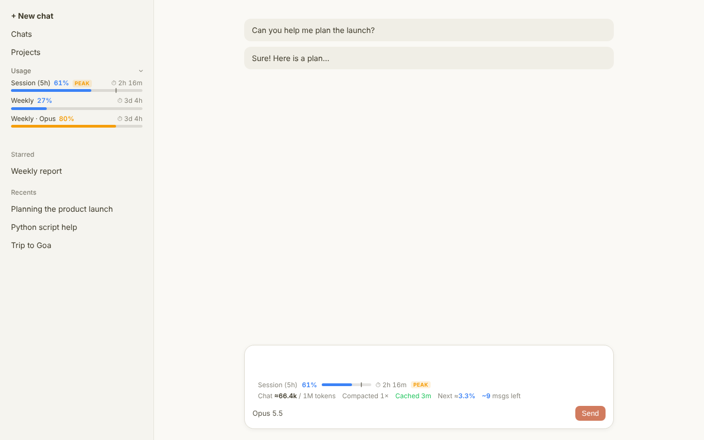

# AI Token Tracker for Claude

A browser extension that shows your **claude.ai usage right inside claude.ai**.
No app, no account, no setup: install it and open claude.ai.

## What it shows

**In claude.ai's left sidebar: a "Usage" section**
- One bar per limit on your plan: **Session (5h)**, **Weekly**, per-model weeklies (Opus, Sonnet…) and **Extra usage** if you have it on
- The percentage used (blue, amber from 70%, red from 90%) and **when each one resets**
- A **PEAK** tag on weekdays 5–11 AM Pacific, when the session limit runs down faster (hover for the times in your own clock)
- A thin mark on the session bar showing the weekly limit for the model you're using
- Click the header to fold it into one line

**Under the message box: one line about the chat you're in**
- **Session** bar with its reset timer, the weekly mark and the PEAK tag
- **Chat length** in tokens, out of the context window of the model you picked (200K to 1M, from Claude's help centre)
- **Compacted 2×**: how many times Claude has summarised the start of a long chat; the length counts from the latest summary
- **Cached 3m / Not cached**: while Claude still has the chat cached (about 5 minutes after the last reply), the next message uses much less of your limit
- **Next ≈ 0.8%**: roughly how much of your session the next message will use
- **~95 msgs left**: about how many more messages fit in your limits

Hover over anything for an explanation.

**Toolbar popup**: the same bars, the current chat's numbers and the settings. If you have more than one account (personal, team) pick which one to see. The icon shows your session % as a badge.

**claude.ai/code**: the session line also shows under Claude Code's prompt box on the web.

**Notifications**: when a limit you'd pushed past a level you choose (default 90%) resets, you get a notification.

## How the numbers are worked out

- **Limits** come from claude.ai's own usage data, the same numbers as *Settings → Usage*. They're exact.
  They refresh every minute while claude.ai is open, right after each reply, and every 5 minutes in the background.
- **Chat length** is counted from the chat's text (messages, thinking, tool calls and results, pasted files) with a
  tokenizer, so it's a close estimate. Images and uploaded files that claude.ai doesn't show as text are estimated.
  Claude's own system prompt isn't included.
  Add an **Anthropic API key** in the settings to count exactly with Anthropic's free token counter.
- **Next message and messages left** are learned from your own use: after each message the extension notes how far
  the bars moved for how many tokens, separately per model (Opus, Sonnet, ...). It shows *learning…* until it has seen
  enough, usually 2 to 5 messages. Messages sent from other devices at the same time make it less precise.

## Install

Each release has two install files:

| File | For |
|---|---|
| `AITokenTracker-Claude-<version>-chrome.zip` | Chrome, Edge, Brave, Arc and other Chromium browsers |
| `AITokenTracker-Claude-<version>-firefox.zip` | Firefox 128 or newer |

**Chrome, Edge, Brave, Arc**
1. Download the `-chrome.zip` from [Releases](../../releases/latest) and unzip it into a folder you'll keep. Chrome runs the extension from that folder.
2. Open `chrome://extensions` (`edge://extensions` in Edge) and turn on **Developer mode** (top right).
3. Click **Load unpacked** and pick the unzipped folder (the one with `manifest.json`).
4. Pin the extension from the puzzle-piece menu, then open or reload claude.ai.

**Firefox**: download the `-firefox.zip` from [Releases](../../releases/latest), open `about:debugging#/runtime/this-firefox`, click **Load Temporary Add-on**
and pick the zip. Firefox removes temporary add-ons when it closes. To keep it installed, the extension has to be signed
on addons.mozilla.org.

**Build them yourself**: run `./build.sh`. The zips appear in `dist/`.

## Updates

- **Installed from a store** (Chrome Web Store, Edge Add-ons, Firefox Add-ons): the browser updates it automatically.
- **Installed from a zip**: once a day it checks GitHub for a newer release. When there is one, the popup shows
  *"Version x.y.z is available"*: download the new zip, replace the files in your folder, and click the reload icon on
  the extension in `chrome://extensions`.

To publish a new version: raise `version` in `manifest.json` and `manifest_firefox.json`, push, then run
**Actions → Release → Run workflow**. GitHub builds both zips and makes the release.

## Settings (in the popup)

- Show or hide the sidebar section, the line under the message box and the toolbar badge
- Choose which bars to show
- Reset notifications on/off, and from which level
- Language: English, हिन्दी, Español, Deutsch, Français, Italiano, Português, Bahasa Indonesia, 日本語, 한국어 (or automatic)
- Anthropic API key (optional): when you save one, the browser asks to allow access to `api.anthropic.com`

## Privacy

Full policy: [PRIVACY.md](PRIVACY.md)

- It only runs on claude.ai and reads what the page already loads for you, with your existing login.
- Nothing is sent anywhere else. The one exception is the optional API key: then the open chat's text is sent to
  Anthropic's token counter (Anthropic already has it, it's your Claude chat).
- Settings and numbers are stored only in your browser.
- A copy installed from a zip asks GitHub once a day for the latest version number. Nothing about you is sent.

## Files

| File | What it does |
|---|---|
| `manifest.json` / `manifest_firefox.json` | Extension setup for Chrome and for Firefox |
| `build.sh` | Builds the Chrome and Firefox install zips into `dist/` |
| `hook.js` | Runs in the page; notices when you send a message and when the reply finishes |
| `content.js` | Reads your usage and the open chat, draws the sidebar section and the line under the message box |
| `shared.js` | Usage parsing, peak hours, context windows and formatting, shared by everything |
| `i18n.js` | Translations (10 languages) |
| `background.js` | Background refresh, toolbar badge, reset notifications, exact token counting, update check |
| `popup.html/.js/.css` | The toolbar popup and settings |
| `styles.css` | Styles for what's added to claude.ai |
| `store/` | Store listing texts, images and upload steps for Chrome, Edge and Firefox |
| `tests/` | Browser test against a stand-in claude.ai page (see `tests/README.md`) |
| `docs/` | Screenshots used in this README |
| `.github/workflows/release.yml` | Builds the zips and publishes a release |
| `tokenizer.js` | Token counter, built from [gpt-tokenizer](https://github.com/niieani/gpt-tokenizer) (MIT). Rebuild with `cd tokenizer-build && npm install && npm run build` |

claude.ai changes its page from time to time. If the sidebar section or the line under the message box stops showing,
the popup and the badge keep working. Please open an issue.

## License

[MIT](LICENSE), © 2026 Surajprem7. `tokenizer.js` is built from [gpt-tokenizer](https://github.com/niieani/gpt-tokenizer) (MIT); see [THIRD_PARTY_NOTICES.md](THIRD_PARTY_NOTICES.md).

Not affiliated with, endorsed by or sponsored by Anthropic. "Claude" is a trademark of Anthropic.

## Support

If it helps you, you can [sponsor the project on GitHub](https://github.com/sponsors/Surajprem7) ❤️
